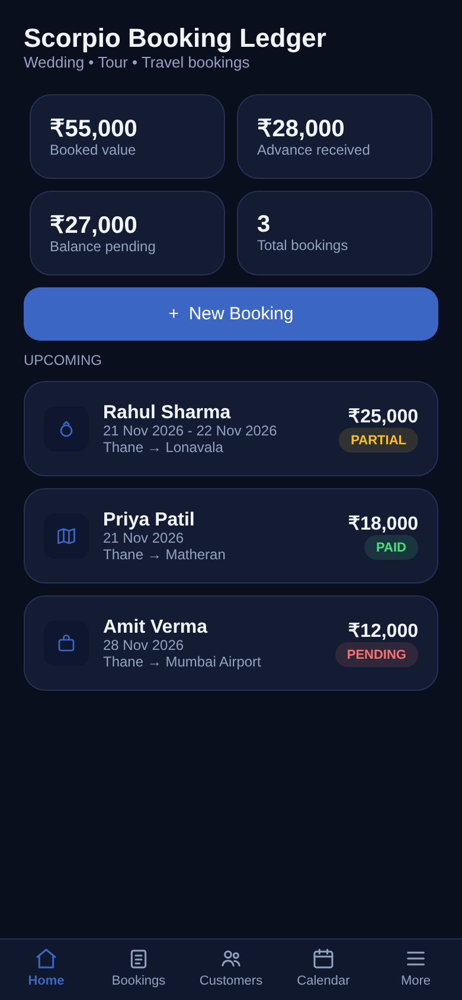
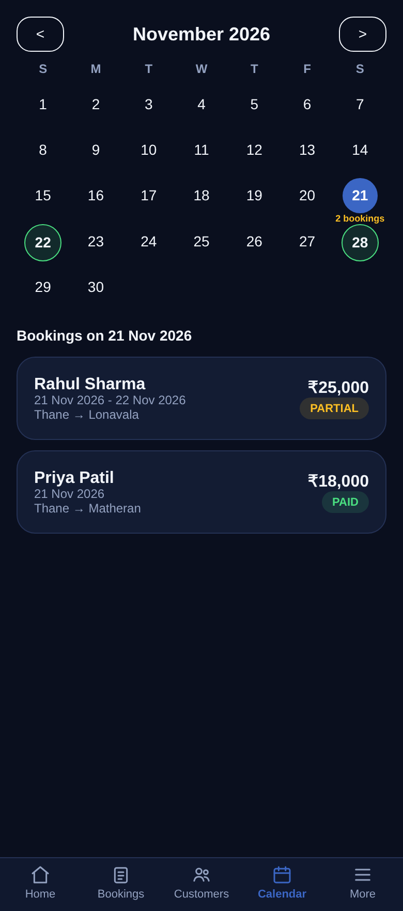
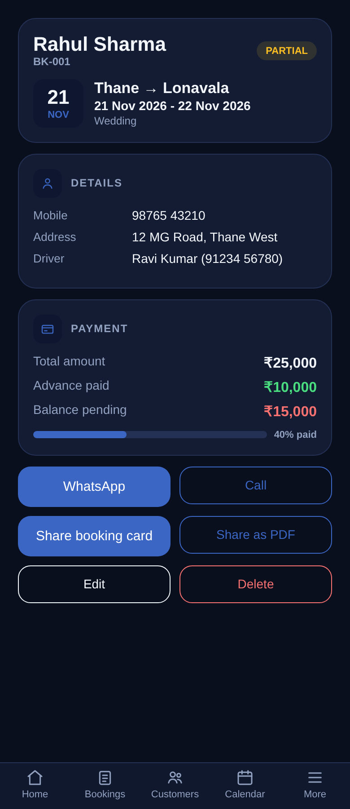
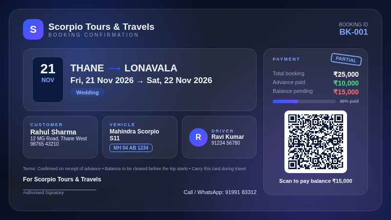

# Scorpio Booking Ledger

A personal, fully offline Android booking ledger for a Mahindra Scorpio S11 rental business (weddings, tours and travels). Keep the whole booking book on your phone: which date is booked, for how much, how much advance came in, and what balance is pending.

## Features

- **Bookings** - customer name, mobile, address, booking type (Wedding / Tour / Travel / Other), single date or date range, pickup and drop locations, total amount, advance paid, notes. Balance is auto-calculated.
- **Double-booking alert** - saving a booking that clashes with an existing one pops a warning showing exactly which booking it clashes with.
- **Calendar view** - month grid with booked days marked; days with more than one booking are flagged; tap any day to see its bookings.
- **Dashboard** - total booked value, advance received, balance pending, total bookings, and the next 5 upcoming bookings at a glance.
- **Search** - find any booking by customer name or phone number. Status chips: PAID / PARTIAL / PENDING.
- **Shareable booking card** - a premium landscape "Midnight Glass" booking confirmation card (PNG or PDF) for the customer: business name and logo mark, booking ID, prominent travel dates, route, customer name/address/phone, Scorpio S11 with number plate, driver name, number and photo, payment breakdown (total / advance / balance) with a progress bar, paid stamp, terms, signature block and a scannable **UPI pay QR** so the customer can pay the balance on the spot. Share straight to WhatsApp. Generated fully offline.
- **Driver details** - driver name, mobile and photo per booking (photo appears on the booking card).
- **WhatsApp / Call buttons** - one tap to WhatsApp or call the customer.
- **UPI payments** - set your UPI ID once (or upload your own pay QR image); every booking card carries a scannable QR pre-filled with the pending balance, booking ID and business name.
- **Backup & restore** - export everything to a JSON file (Downloads, Drive, anywhere) and restore it later. All data stays on the phone.
- **Dark & light mode**, premium navy/white design.
- **100% offline** - no internet permission, no account, no server, no ads, no cost. Your data never leaves the phone.

## Install

1. Download `scorpio-booking-ledger.apk` from [Releases](../../releases).
2. Open it on your Android phone and allow "install from unknown sources" when asked.
3. Set your business name and contact number under **More > Your business** so they appear on the booking card.

Requires Android 7.0 (API 24) or newer.

## Screenshots

| Home | Calendar | Booking detail (dark) | Booking card |
|---|---|---|---|
|  |  |  |  |

## Tech

- Pure native Android (Java, single activity, programmatic UI) - no third-party libraries, no internet permission.
- ~46 KB APK, hand-built with `aapt2` + `d8` + `apksigner` (see `build.sh`).
- Data stored as JSON in app-private storage; backup/restore via Storage Access Framework.
- Booking cards rendered with `Canvas`/`PdfDocument` and shared through a minimal in-app `ContentProvider`.
- Logic tests for date/money math and backup JSON round-trip are in `test/`.

## Build

Requires Android SDK build-tools 34 and platform android-34 (`android.jar`):

```bash
./build.sh
```

Outputs a signed `scorpio-booking-ledger.apk`.
